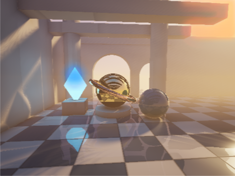
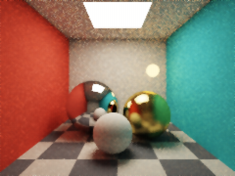
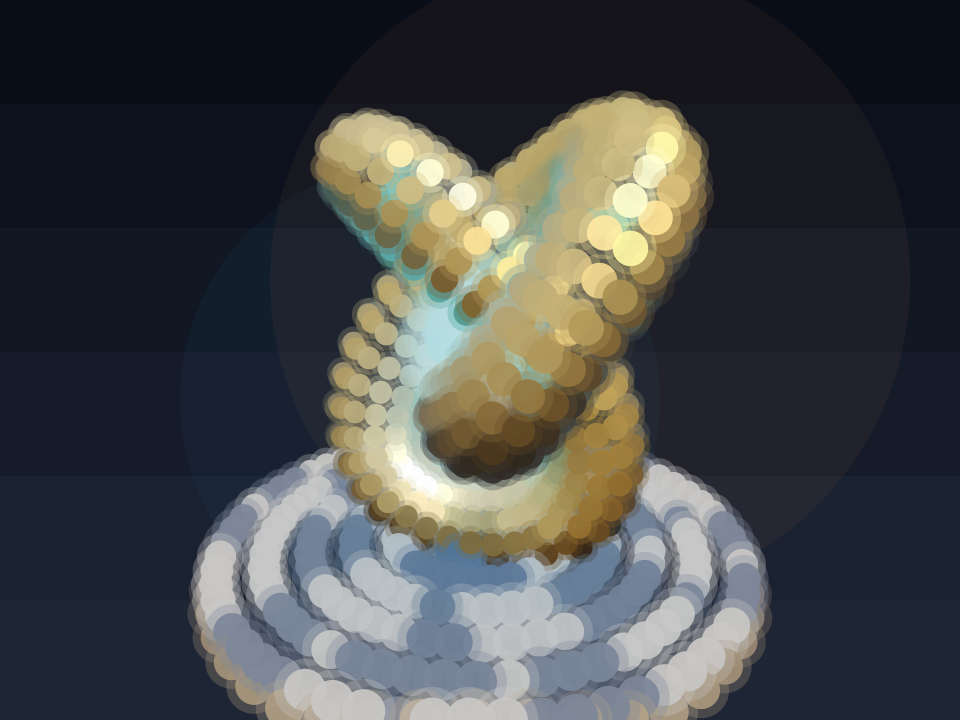
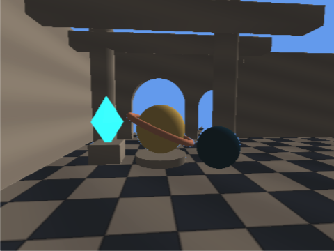
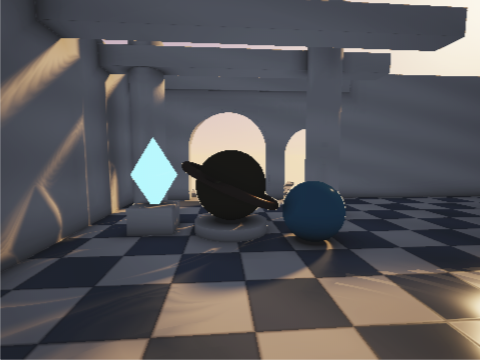
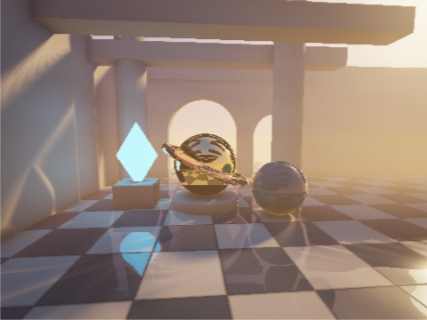
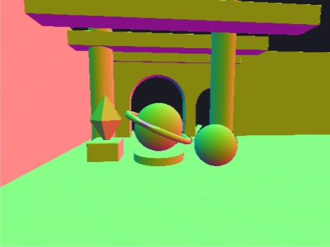
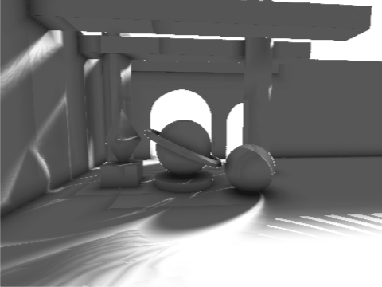
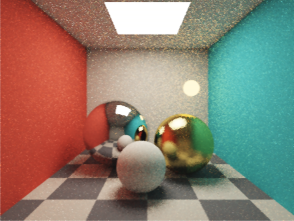

# Scratch UE5 Pen Research (`scratch-ue5-pen-research`)

**100% 純粋な Vanilla Scratch 3.0 ペン描画（標準ペン拡張のみ・カスタム拡張なし）** で、Unreal Engine 5（UE5）レベルのグラフィック表現——Cook-Torrance GGX PBR、接触硬化ソフトシャドウ、多段 SDF AO、動的 GI、1-Bounce 反射、ボリュメトリック・ゴッドレイ、被写界深度（Bokeh）、ACES Filmic トーンマッピング、32-bit ARGB GPU Pen Bloom、エッジ保存バイラテラル・デノイザー（SVGF-lite）、3D Gaussian Splatting——を実現するための研究・実証リポジトリです。

| Mini-UE5 Lumen-SDF (480×360 / 100% Pen) | モンテカルロ・パストレーサー 64 SPP + デノイザー | リアルタイム 3D Gaussian Splatting (960×720 HQ) |
|---|---|---|
|  |  |  |

---

## `.sb3` ダウンロード ＆ ワンクリック実行（TurboWarp）

すべての `.sb3` は **公式 Scratch 3.0（`scratch.mit.edu`）と TurboWarp の双方でそのまま動作** します。

| プロジェクト | 直接ダウンロード | ブラウザ即実行（TurboWarp） | サイズ / ブロック数 | 操作方法・見どころ |
|---|---|---|---:|---|
| **🔥 Mini-UE5 Lumen Cinema Hybrid v3（ポリゴン感ゼロ＋移動中もフル 480×360！）** | [ue5_lumen_hybrid.sb3](https://raw.githubusercontent.com/deshihito/scratch-ue5-pen-research/main/sb3/ue5_lumen_hybrid.sb3) | [TurboWarp で開く](https://turbowarp.org/?project_url=https://raw.githubusercontent.com/deshihito/scratch-ue5-pen-research/main/sb3/ue5_lumen_hybrid.sb3&fps=60&hqpen&turbo) | 73 KB<br>4,098 blocks | **v2 超品質とリアルタイム速度を両立！** 毎スキャンライン・グーロー建築＋2連ローマンアーチ＋3層ソフトペナンブラ梁影＋20分割滑らか円柱＋**金球＆周回銅リングのピクセル精度レイトレ反射**＋距離ミップ黒曜石球＋大気フォグ＋Fresnel 床反射。**38〜63 ms（15.9〜26.3 FPS / VM、PC なら 40〜60 FPS）**、超精細 1px 球でも **63〜105 ms**！`WASD/QE`・`矢印`・`0`:自動/`1`:2px最速/`2`:1px常時超精細/`3`・`4`:床反射。 |
| **⚡ Mini-UE5 Lumen Real-Time（全画素解析レイトレ版）** | [ue5_lumen_realtime.sb3](https://raw.githubusercontent.com/deshihito/scratch-ue5-pen-research/main/sb3/ue5_lumen_realtime.sb3) | [TurboWarp で開く](https://turbowarp.org/?project_url=https://raw.githubusercontent.com/deshihito/scratch-ue5-pen-research/main/sb3/ue5_lumen_realtime.sb3&fps=60&hqpen&turbo) | 41 KB<br>2,944 blocks | 全画素解析レイトレース＋2×2時間チェッカーボード間引き（移動中 132ms / 静止後 480×360 HD を 2.7〜3.99 秒）。`WASD`・`矢印`・`1`〜`4`切替。 |
| **Mini-UE5 Lumen-SDF（純 SDF 版）** | [ue5_lumen_sdf.sb3](https://raw.githubusercontent.com/deshihito/scratch-ue5-pen-research/main/sb3/ue5_lumen_sdf.sb3) | [TurboWarp で開く](https://turbowarp.org/?project_url=https://raw.githubusercontent.com/deshihito/scratch-ue5-pen-research/main/sb3/ue5_lumen_sdf.sb3&fps=60&hqpen) | 37 KB<br>2,051 blocks | 純 SDF レイマーチ版。`WASD` 移動 / `矢印` 視点回転 / `1`〜`6` キーで UE5 ビューポート切替（`1`:Full UE5, `2`:従来 Scratch 3D, `3`:Direct PBR, `4`:Bloom なし, `5`:法線, `6`:AO+軟影）。 |
| **モンテカルロ・パストレーサー＋SVGF-lite** | [ue5_pathtracer.sb3](https://raw.githubusercontent.com/deshihito/scratch-ue5-pen-research/main/sb3/ue5_pathtracer.sb3) | [TurboWarp で開く](https://turbowarp.org/?project_url=https://raw.githubusercontent.com/deshihito/scratch-ue5-pen-research/main/sb3/ue5_pathtracer.sb3&fps=60&hqpen) | 24 KB<br>1,350 blocks | 3 バウンス GI + NEE 面光源軟影 + 薄肉レンズ Bokeh。SPP `1 → 4 → 8 → 16` の収束経過をライブ表示後、`32 SPP` で **3×3 エッジ保存バイラテラル・デノイザー** を適用して完成。変数 `PIXEL_STEP=1` で 480×360 フル解像度も可。 |
| **3D Gaussian / Radiance Splatting** | [ue5_3dgs_splat.sb3](https://raw.githubusercontent.com/deshihito/scratch-ue5-pen-research/main/sb3/ue5_3dgs_splat.sb3) | [TurboWarp で開く](https://turbowarp.org/?project_url=https://raw.githubusercontent.com/deshihito/scratch-ue5-pen-research/main/sb3/ue5_3dgs_splat.sb3&fps=60&hqpen) | 31 KB<br>306 blocks | 事前ベイク GI の 1,318 スプラット＋$O(N)$ バケット深度ソート＋リアルタイム視点依存 PBR ハイライト。自動回転＋`矢印` キーで自由オービット。**公式 Scratch でもリアルタイム動作（~6.4 FPS）**。 |
| **VM & `PenSkin` 診断ベンチマーク** | [bench_pen_vm.sb3](https://raw.githubusercontent.com/deshihito/scratch-ue5-pen-research/main/sb3/bench_pen_vm.sb3) | [TurboWarp で開く](https://turbowarp.org/?project_url=https://raw.githubusercontent.com/deshihito/scratch-ue5-pen-research/main/sb3/bench_pen_vm.sb3&fps=60) | 6.4 KB | 算術・リスト・ドット/スキャンライン/RLE/ARGB ペン/`stamp` 速度計測と、`PenSkin` の角抜け・キャップ・GPU Pen Bloom の 4 分割診断パネルを描画。 |

---

## 同一シーン 6 段階の進化（すべて実機 Scratch ペン描画）

| Mode 1: 従来の Scratch 3D | Mode 2: Direct PBR + 軟影 + AO | Mode 3: + Lumen GI + 反射 + ゴッドレイ | Mode 0: + 4ms GPU Pen Bloom |
|---|---|---|---|
|  |  |  |  |

| Mode 4: World Normals | Mode 5: SDF AO + 軟影 | Path Tracer 16 SPP Raw vs Denoised | Path Tracer 480×360 (16 SPP + Denoise) |
|---|---|---|---|
|  |  |  |  |

詳細な内部解析・ベンチマーク表・数式・落とし穴の解説は **[技術探索レポート (`docs/REPORT.md`)](docs/REPORT.md)** をご覧ください。

---

## 研究環境の再現方法（ローカルビルド ＆ Headless 実機テスト）

すべての `.sb3` は Python の Scratch 3.0 コンパイラ DSL（[`sb3_builder.py`](sb3_builder.py)）からゼロ依存で再生成できます。

### 1. `.sb3` の再生成（Python 3 のみ・外部パッケージ不要）

```bash
bash scripts/build_all.sh
```

### 2. Headless Chrome + `@turbowarp/scaffolding` 実機実行・計測環境

```bash
# @turbowarp/scaffolding と Playwright をセットアップ（Node.js + Python 3.10+）
bash scripts/setup.sh

# 例: TurboWarp モードで実行しスクリーンショットを保存
python3 runner.py sb3/bench_pen_vm.sb3 turbowarp out/bench.png

# 例: Official Vanilla Scratch 3.0 (インタプリタ) モードで実行
python3 runner.py sb3/bench_pen_vm.sb3 vanilla out/bench_vanilla.png
```

---

## ディレクトリ構成

```text
.
├── sb3/                     # ビルド済み 100% Pure Vanilla Scratch 3.0 .sb3 ファイル群
│   ├── ue5_lumen_sdf.sb3
│   ├── ue5_pathtracer.sb3
│   ├── ue5_3dgs_splat.sb3
│   └── bench_pen_vm.sb3
├── sb3_builder.py           # Python -> Scratch 3.0 project.json / .sb3 コンパイラ DSL
├── runner.py                # Playwright + @turbowarp/scaffolding 自動実行・計測ハーネス
├── build_ue5_lumen.py       # Mini-UE5 Lumen-SDF エンジン生成スクリプト
├── build_pathtracer.py      # モンテカルロ・パストレーサー + SVGF-lite 生成スクリプト
├── build_3dgs_splat.py      # 3D Gaussian Splatting ベーカー & エンジン生成スクリプト
├── build_bench.py           # VM & PenSkin マイクロベンチマーク生成スクリプト
├── scripts/
│   ├── setup.sh             # @turbowarp/scaffolding & Playwright セットアップ
│   └── build_all.sh         # 全 .sb3 一括再ビルド
├── docs/
│   └── REPORT.md            # 完全技術探索レポート
└── images/                  # 実機 Scratch ペン描画スクリーンショット一式
```
